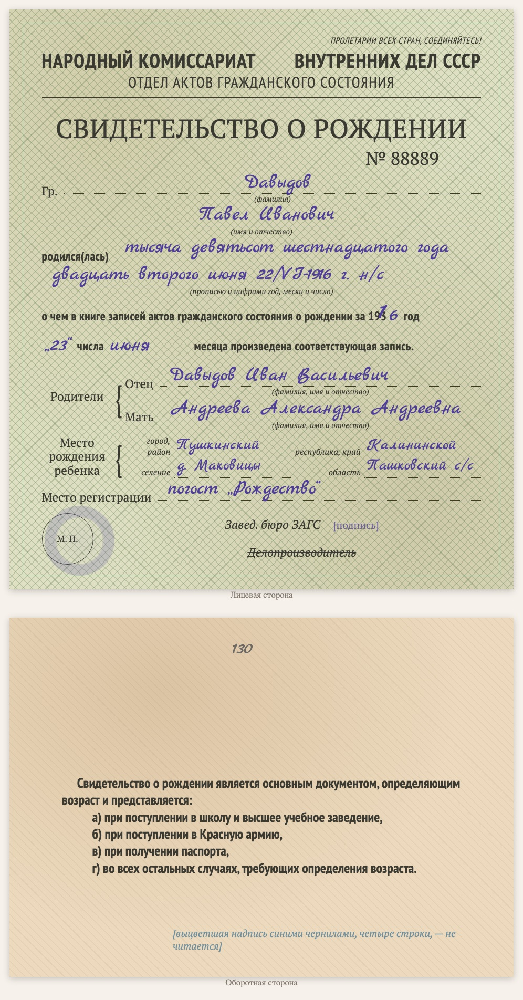

# replica-birth-certificate-1936

Sprachen: [English](README.md) / [Русский](README.ru.md) / [Українська](README.uk.md) / [Deutsch](README.de.md)

Teil der Sammlung [genealogy-skills](../README.de.md).

Erstellt eine **gesetzte Kopie einer sowjetischen Geburtsurkunde der späten 1930er Jahre** (Formular des Standesamts beim NKWD der UdSSR, «за 193_ год»), auch von Zweitschriften, die nach einem Kirchenbuch vor 1917 ausgestellt wurden. Kein Scan, sondern ein HTML/CSS-Blatt nach dem Vorbild des Originals: dieselben Felder, der gedruckte Formulartext, die Handschrift in einer Schreibschrift, das Siegel als verblasster Kreis. Die Kopie steht auf einer Dokumentseite der Website zusammen mit der wörtlichen Abschrift (Handschrift in blauer Kursive) und Lesehinweisen; unten steht, mit welchem Skill sie erstellt wurde.

Beispiel: [D1000 — Geburtsurkunde von Pawel Dawydow](https://usuyukiso.github.io/family-history/sources/documents/D1000-svidetelstvo-o-rozhdenii-davydov-pavel-1930e/).

## Starten

Der Skill startet von selbst, wenn Ihre Bitte passt, zum Beispiel:

- „Zeichne die Geburtsurkunde 1916.06.22_birth_DavPavelIvan.tif nach dem Formular nach.“
- „Erstelle eine Kopie dieser Geburtsurkunde aus den 1930er Jahren.“

Oder direkt: `/replica-birth-certificate-1936 <Scan-Datei>`.

## Ergebnis

- Eine Dokumentseite `D####` mit der Formularkopie, der Abschrift, Hinweisen zu Datierung und Lesung, verknüpft mit den genannten Personen.
- Die Seite im Menü, in der Quellenliste, in der internen Prüfliste und auf den Personenseiten.
- Eine Liste unsicherer Lesungen (Unterschriften, Stempel, Falzstellen) zum Abgleich mit dem Scan.

## Voraussetzungen

- Der Scan (PDF, TIFF oder JPEG). Unter macOS werden PDFs mit dem eingebauten PDFKit gerendert.
- Einmal pro Website: die Stile aus [assets/replica.css](assets/replica.css), die Schriften und zwei kleine MkDocs-Hooks (siehe SKILL.md).

Die Anweisungen für den Agenten stehen in [SKILL.md](SKILL.md).
