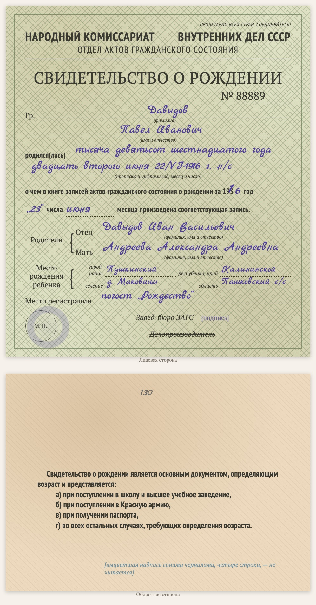

# replica-birth-certificate-1936

Languages: [English](README.md) / [Русский](README.ru.md) / [Українська](README.uk.md) / [Deutsch](README.de.md)

Part of the [genealogy-skills](../README.md) set.

Makes a **typed copy of a Soviet birth certificate of the late 1930s** (NKVD USSR ZAGS form, «за 193_ год»), including repeat certificates written out from a pre-1917 church register. It is not a scan but an HTML/CSS sheet laid out like the original: the same fields, the printed text of the form, the handwriting in a script font, the seal as a faded circle. The copy goes on a document page of the website together with a verbatim transcript (handwriting in blue italics) and reading notes; at the bottom the page says which skill made it.

Example: [D1000 — birth certificate of Pavel Davydov](https://usuyukiso.github.io/family-history/sources/documents/D1000-svidetelstvo-o-rozhdenii-davydov-pavel-1930e/).

## How to start

The skill starts by itself when your request fits it, for example:

- "Draw the birth certificate 1916.06.22_birth_DavPavelIvan.tif after the blank form."
- "Make a replica of this 1930s birth certificate."

Or start it directly: `/replica-birth-certificate-1936 <scan file>`.

## What you get

- A document page `D####` with the copy of the form, the transcript, notes on dating and readings, linked to the people on it.
- The page added to the menu, the list of sources, the internal check list and the person pages.
- A list of uncertain readings (signatures, stamps, folds) for you to check on the scan.

## What it needs

- The scan (PDF, TIFF or JPEG). macOS renders PDFs with the built-in PDFKit.
- Once per site: the styles from [assets/replica.css](assets/replica.css), the fonts and two small MkDocs hooks (see SKILL.md).

The instructions the agent follows are in [SKILL.md](SKILL.md).
