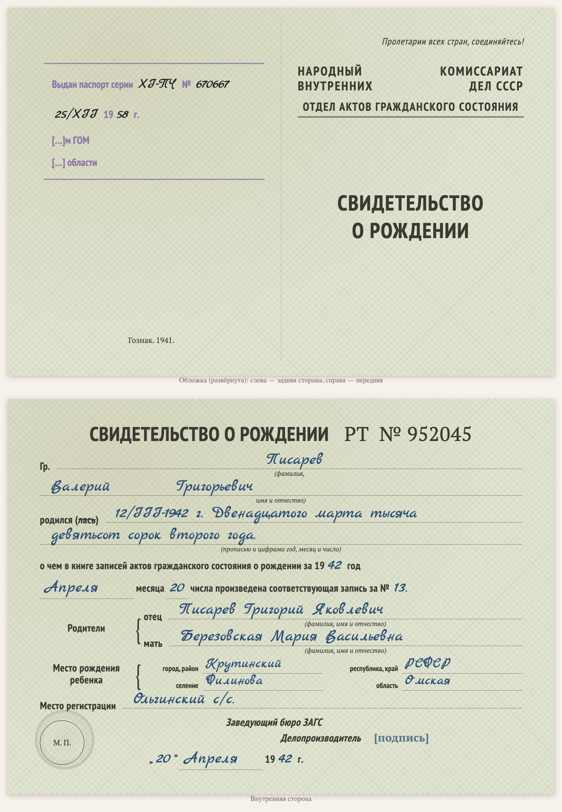

# replica-birth-certificate-1940s

Sprachen: [English](README.md) / [Русский](README.ru.md) / [Українська](README.uk.md) / [Deutsch](README.de.md)

Teil der Sammlung [genealogy-skills](../README.de.md).

Erstellt eine **gesetzte Kopie einer sowjetischen Geburtsurkunde der Kriegsjahre** (etwa 1941–1946: Formular des Standesamts beim NKWD der UdSSR, ein gefaltetes Querformatblatt, Serie und Nummer wie «РТ № 952045»). Kein Scan, sondern eine HTML/CSS-Kopie nach dem Vorbild des Originals: der aufgeklappte Umschlag (Vorderseite und Rückseite mit dem Goznak-Vermerk und ggf. einem Passstempel) und die Innenseite mit denselben Feldern, dem gedruckten Text und der Handschrift in einer Schreibschrift. Die Kopie steht auf einer Dokumentseite der Website zusammen mit der wörtlichen Abschrift (Handschrift in blauer Kursive) und Lesehinweisen; unten steht, mit welchem Skill sie erstellt wurde.

Beispiel: [D1001 — Geburtsurkunde von Walerij Pisarew, 1942](https://usuyukiso.github.io/family-history/sources/documents/D1001-svidetelstvo-o-rozhdenii-pisarev-valeriy-1942/).

## Starten

Der Skill startet von selbst, wenn Ihre Bitte passt, zum Beispiel:

- „Zeichne die Geburtsurkunde von 1944 nach dem Formular nach.“
- „Erstelle eine Kopie dieser Geburtsurkunde aus den 1940er Jahren.“

Oder direkt: `/replica-birth-certificate-1940s <Scan-Datei>`.

## Ergebnis

- Eine Dokumentseite `D####` mit der Formularkopie, der Abschrift, Hinweisen zu Datierung und Lesung, verknüpft mit den genannten Personen.
- Die Seite im Menü, in der Quellenliste, in der internen Prüfliste und auf den Personenseiten.
- Eine Liste unsicherer Lesungen (Unterschriften, Stempel, Falzstellen) zum Abgleich mit dem Scan.

## Voraussetzungen

- Der Scan (PDF, TIFF oder JPEG). Unter macOS werden PDFs mit dem eingebauten PDFKit gerendert.
- Einmal pro Website: die Stile aus [assets/replica.css](assets/replica.css), die Schriften und zwei kleine MkDocs-Hooks (siehe SKILL.md).

Die Anweisungen für den Agenten stehen in [SKILL.md](SKILL.md).
