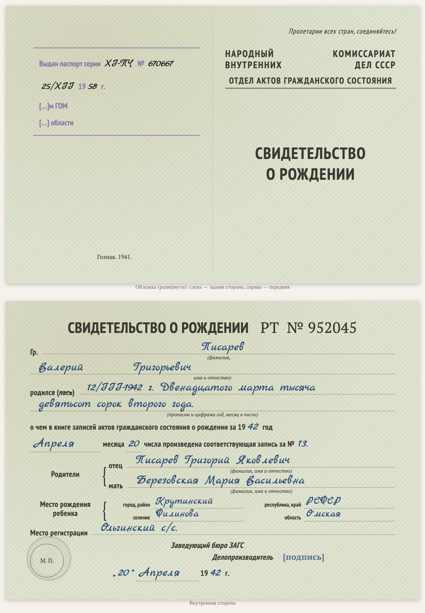

# replica-birth-certificate-1940s

Языки: [English](README.md) / [Русский](README.ru.md) / [Українська](README.uk.md) / [Deutsch](README.de.md)

Входит в набор [genealogy-skills](../README.ru.md).

Делает **набранную копию советского свидетельства о рождении военных лет** (примерно 1941–1946: бланк отдела ЗАГС НКВД СССР, альбомный лист, сложенный пополам, серия и номер вроде «РТ № 952045»). Это не скан, а копия на HTML/CSS по образцу оригинала: развёрнутая обложка (передняя сторона и задняя — с выходными данными Гознака и штампом о выдаче паспорта, если он есть) и внутренняя сторона с теми же графами, печатным текстом и вписанным от руки — рукописным шрифтом. Копия ставится на страницу документа вместе с дословным текстом (вписанное от руки — синим курсивом) и пояснениями к прочтению; внизу страницы указано, каким навыком она сделана.

Пример: [D1001 — свидетельство о рождении Валерия Писарева, 1942](https://usuyukiso.github.io/family-history/sources/documents/D1001-svidetelstvo-o-rozhdenii-pisarev-valeriy-1942/).

## Как запустить

Навык запустится сам, если ваша просьба ему подходит, например:

- «Отрисуй свидетельство о рождении 1944 года по образцу бланка»
- «Сделай копию бланка свидетельства о рождении 1940-х»

Или запустите напрямую: `/replica-birth-certificate-1940s <файл скана>`.

## Что получится

- Страница документа `D####`: копия бланка, текст, пояснения к датировке и прочтению, связи с людьми.
- Страница добавлена в меню, в список источников, во внутренний список проверки и на страницы людей.
- Список сомнительных мест (подписи, печати, сгибы) — чтобы вы сверили их со сканом.

## Что нужно

- Скан (PDF, TIFF или JPEG). На macOS PDF отрисовывается встроенным PDFKit.
- Один раз на сайт: стили из [assets/replica.css](assets/replica.css), шрифты и два небольших хука MkDocs (см. SKILL.md).

Инструкции, которым следует агент, — в [SKILL.md](SKILL.md).
