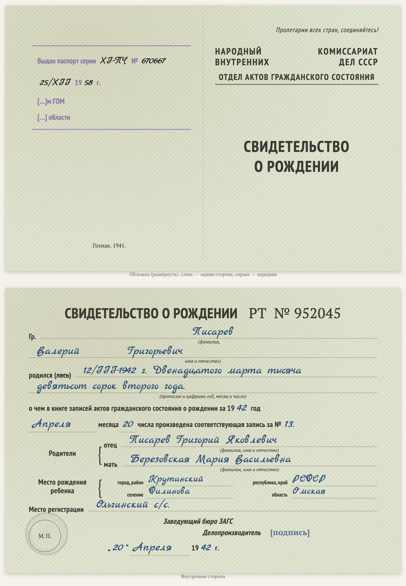

# replica-birth-certificate-1940s

Мови: [English](README.md) / [Русский](README.ru.md) / [Українська](README.uk.md) / [Deutsch](README.de.md)

Входить до набору [genealogy-skills](../README.uk.md).

Робить **набрану копію радянського свідоцтва про народження воєнних років** (приблизно 1941–1946: бланк відділу РАЦС НКВС СРСР, альбомний аркуш, складений навпіл, серія й номер на кшталт «РТ № 952045»). Це не скан, а копія на HTML/CSS за зразком оригіналу: розгорнута обкладинка (передній бік і задній — з вихідними даними Держзнаку та штампом про видачу паспорта, якщо він є) і внутрішній бік із тими самими графами, друкованим текстом і вписаним від руки — рукописним шрифтом. Копія ставиться на сторінку документа разом із дослівним текстом (вписане від руки — синім курсивом) і поясненнями до прочитання; унизу сторінки зазначено, якою навичкою її зроблено.

Приклад: [D1001 — свідоцтво про народження Валерія Писарева, 1942](https://usuyukiso.github.io/family-history/sources/documents/D1001-svidetelstvo-o-rozhdenii-pisarev-valeriy-1942/).

## Як запустити

Навичка запуститься сама, якщо ваше прохання їй підходить, наприклад:

- «Отрисуй свидетельство о рождении 1944 года по образцу бланка»
- «Зроби копію бланка свідоцтва про народження 1940-х»

Або запустіть напряму: `/replica-birth-certificate-1940s <файл скану>`.

## Що вийде

- Сторінка документа `D####`: копія бланка, текст, пояснення до датування й прочитання, зв'язки з людьми.
- Сторінку додано до меню, до списку джерел, до внутрішнього списку перевірки та на сторінки людей.
- Список сумнівних місць (підписи, печатки, згини), щоб ви звірили їх зі сканом.

## Що потрібно

- Скан (PDF, TIFF або JPEG). На macOS PDF малюється вбудованим PDFKit.
- Один раз на сайт: стилі з [assets/replica.css](assets/replica.css), шрифти й два невеликі хуки MkDocs (див. SKILL.md).

Інструкції, яких дотримується агент, — у [SKILL.md](SKILL.md).
