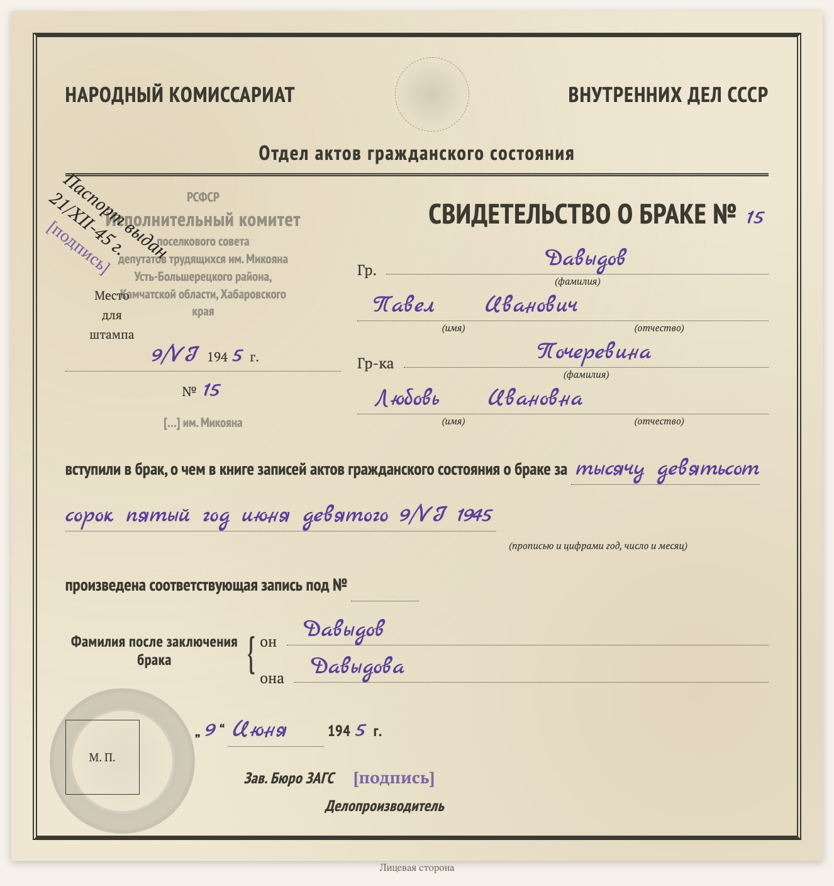

# replica-marriage-certificate-1940s

Sprachen: [English](README.md) / [Русский](README.ru.md) / [Українська](README.uk.md) / [Deutsch](README.de.md)

Teil der Sammlung [genealogy-skills](../README.de.md).

Erstellt eine **gesetzte Kopie einer sowjetischen Heiratsurkunde der 1940er Jahre** (Formular des Standesamts beim NKWD der UdSSR, Querformat: links der Stempel des Standesamts, Ort und Datum der Ausstellung, rechts «Гр. … и гр. … вступили в брак …» und die Familiennamen nach der Eheschließung). Kein Scan, sondern ein HTML/CSS-Blatt nach dem Vorbild des Originals: dieselben Felder, der gedruckte Text, die Handschrift in einer Schreibschrift, Stempel und Siegel als blasse Abdrücke. Die Kopie steht auf einer Dokumentseite der Website zusammen mit der wörtlichen Abschrift (Handschrift in blauer Kursive) und Lesehinweisen; unten steht, mit welchem Skill sie erstellt wurde.

Beispiel: [D1008 — Heiratsurkunde von Pawel Dawydow und Ljubow Potscherewina, 1945](https://usuyukiso.github.io/family-history/sources/documents/D1008-svidetelstvo-o-brake-davydov-pavel-1945/).

## Starten

Der Skill startet von selbst, wenn Ihre Bitte passt, zum Beispiel:

- «Отрисуй свидетельство о браке 1945 года по образцу бланка»
- "Make a replica of this 1940s marriage certificate."

Oder direkt: `/replica-marriage-certificate-1940s <Scan-Datei>`.

## Ergebnis

- Eine Dokumentseite `D####` mit der Formularkopie, der Abschrift, Hinweisen zu Stempeln, Daten und Lesung, verknüpft mit beiden Eheleuten.
- Die Seite im Menü, in der Quellenliste, in der internen Prüfliste und auf beiden Personenseiten.
- Eine Liste unsicherer Lesungen (Stempel, Siegel, Unterschriften) zum Abgleich mit dem Scan.

## Voraussetzungen

- Der Scan (PDF, TIFF oder JPEG). Unter macOS werden PDFs mit dem eingebauten PDFKit gerendert.
- Einmal pro Website: die Stile aus [assets/replica.css](assets/replica.css), die Schriften und zwei kleine MkDocs-Hooks (siehe SKILL.md).

Die Anweisungen für den Agenten stehen in [SKILL.md](SKILL.md).
