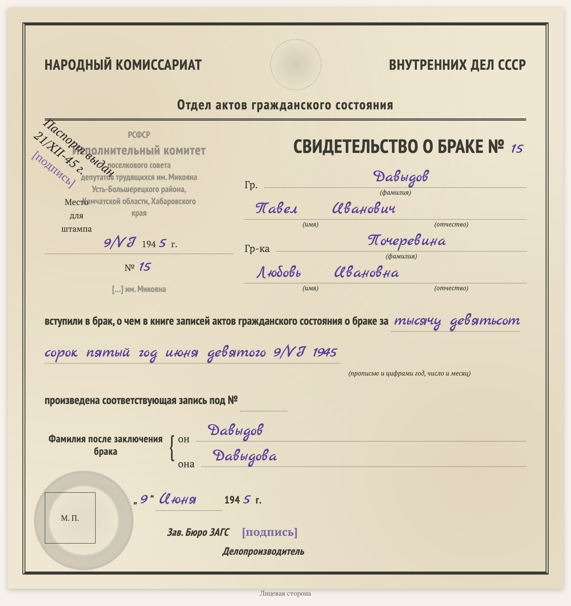

# replica-marriage-certificate-1940s

Languages: [English](README.md) / [Русский](README.ru.md) / [Українська](README.uk.md) / [Deutsch](README.de.md)

Part of the [genealogy-skills](../README.md) set.

Makes a **typed copy of a Soviet marriage certificate of the 1940s** (NKVD USSR ZAGS form, a landscape sheet: on the left the stamp of the ZAGS office, place and date of issue, on the right «Гр. … и гр. … вступили в брак …» and the surnames after marriage). It is not a scan but an HTML/CSS sheet laid out like the original: the same fields, the printed text, the handwriting in a script font, stamps and seals as faded prints. The copy goes on a document page of the website together with a verbatim transcript (handwriting in blue italics) and reading notes; at the bottom the page says which skill made it.

Example: [D1008 — marriage certificate of Pavel Davydov and Lyubov Pocherevina, 1945](https://usuyukiso.github.io/family-history/sources/documents/D1008-svidetelstvo-o-brake-davydov-pavel-1945/).

## How to start

The skill starts by itself when your request fits it, for example:

- "Draw the 1945 marriage certificate after the blank form."
- "Make a replica of this 1940s marriage certificate."

Or start it directly: `/replica-marriage-certificate-1940s <scan file>`.

## What you get

- A document page `D####` with the copy of the form, the transcript, notes on the stamps, dates and readings, linked to both spouses.
- The page added to the menu, the list of sources, the internal check list and both person pages.
- A list of uncertain readings (stamps, seals, signatures) for you to check on the scan.

## What it needs

- The scan (PDF, TIFF or JPEG). macOS renders PDFs with the built-in PDFKit.
- Once per site: the styles from [assets/replica.css](assets/replica.css), the fonts and two small MkDocs hooks (see SKILL.md).

The instructions the agent follows are in [SKILL.md](SKILL.md).
