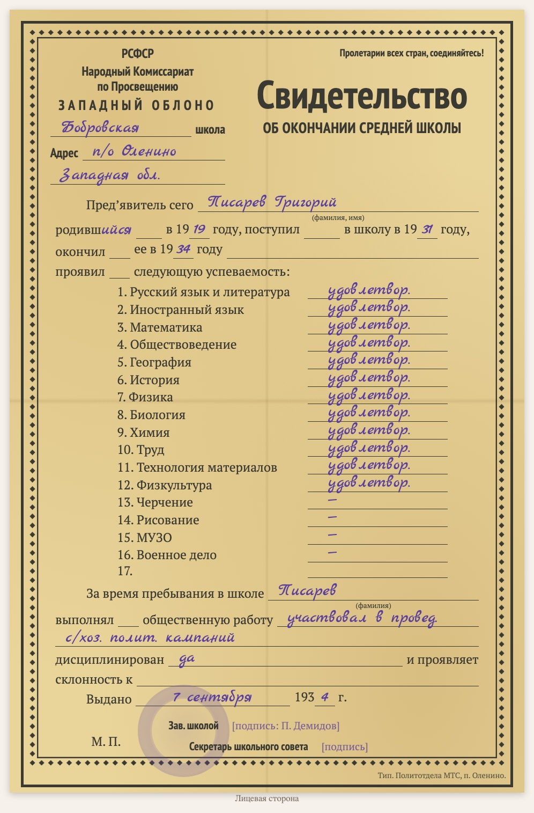

# replica-school-certificate-1930s

Sprachen: [English](README.md) / [Русский](README.ru.md) / [Українська](README.uk.md) / [Deutsch](README.de.md)

Teil der Sammlung [genealogy-skills](../README.de.md).

Erstellt eine **gesetzte Kopie eines sowjetischen Schulabschlusszeugnisses der 1930er Jahre** («Свидетельство об окончании … школы» auf dem Formular einer Gebietsschulbehörde: Fächer mit Noten, gesellschaftliche Arbeit, Disziplin, Ausstellungsdatum, Schulleiter, Sekretär des Schulrats). Kein Scan, sondern ein HTML/CSS-Blatt nach dem Vorbild des Originals: der Ornamentrahmen, dieselben Zeilen, der gedruckte Text, die Handschrift in einer Schreibschrift, das Schulsiegel als verblasster Kreis. Die Kopie steht auf einer Dokumentseite der Website zusammen mit der wörtlichen Abschrift (Handschrift in blauer Kursive) und Lesehinweisen; unten steht, mit welchem Skill sie erstellt wurde.

Beispiel: [D1009 — Schulzeugnis von Grigorij Pisarew, 1934](https://usuyukiso.github.io/family-history/sources/documents/D1009-svidetelstvo-ob-okonchanii-shkoly-pisarev-grigoriy-1934/).

## Starten

Der Skill startet von selbst, wenn Ihre Bitte passt, zum Beispiel:

- „Zeichne 1934.09.07_PisarevGrigYak_School_certificate.pdf nach dem Formular nach.“
- „Erstelle eine Kopie dieses Schulzeugnisses aus den 1930er Jahren.“

Oder direkt: `/replica-school-certificate-1930s <Scan-Datei>`.

## Ergebnis

- Eine Dokumentseite `D####` mit der Formularkopie, der Abschrift, Hinweisen zu Datierung, Noten und Lesung, verknüpft mit dem Schüler.
- Die Seite im Menü, in der Quellenliste, in der internen Prüfliste und auf der Personenseite.
- Eine Liste unsicherer Lesungen (Fächer auf Falzstellen, Unterschriften, Siegel) zum Abgleich mit dem Scan.

## Voraussetzungen

- Der Scan (PDF, TIFF oder JPEG). Unter macOS werden PDFs mit dem eingebauten PDFKit gerendert.
- Einmal pro Website: die Stile aus [assets/replica.css](assets/replica.css), die Schriften und zwei kleine MkDocs-Hooks (siehe SKILL.md).

Die Anweisungen für den Agenten stehen in [SKILL.md](SKILL.md).
