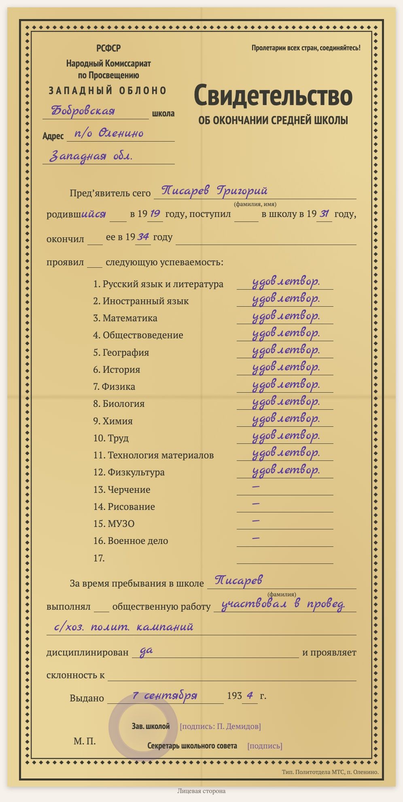

# replica-school-certificate-1930s

Languages: [English](README.md) / [Русский](README.ru.md) / [Українська](README.uk.md) / [Deutsch](README.de.md)

Part of the [genealogy-skills](../README.md) set.

Makes a **typed copy of a Soviet school-leaving certificate of the 1930s** («Свидетельство об окончании … школы» on the form of an oblast education department: subjects with marks, social work, discipline, date of issue, head of school, school council secretary). It is not a scan but an HTML/CSS sheet laid out like the original: the ornamental frame, the same lines, the printed text, the handwriting in a script font, the school seal as a faded circle. The copy goes on a document page of the website together with a verbatim transcript (handwriting in blue italics) and reading notes; at the bottom the page says which skill made it.

Example: [D1009 — school certificate of Grigoriy Pisarev, 1934](https://usuyukiso.github.io/family-history/sources/documents/D1009-svidetelstvo-ob-okonchanii-shkoly-pisarev-grigoriy-1934/).

## How to start

The skill starts by itself when your request fits it, for example:

- «Отрисуй 1934.09.07_PisarevGrigYak_School_certificate.pdf по образцу бланка»
- "Make a replica of this 1930s school certificate."

Or start it directly: `/replica-school-certificate-1930s <scan file>`.

## What you get

- A document page `D####` with the copy of the form, the transcript, notes on dating, marks and readings, linked to the pupil.
- The page added to the menu, the list of sources, the internal check list and the person page.
- A list of uncertain readings (subjects on folds, signatures, the seal) for you to check on the scan.

## What it needs

- The scan (PDF, TIFF or JPEG). macOS renders PDFs with the built-in PDFKit.
- Once per site: the styles from [assets/replica.css](assets/replica.css), the fonts and two small MkDocs hooks (see SKILL.md).

The instructions the agent follows are in [SKILL.md](SKILL.md).
