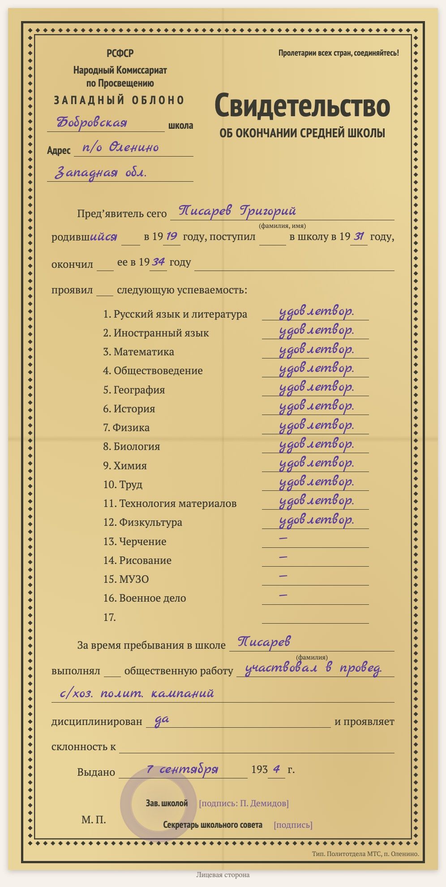

# replica-school-certificate-1930s

Языки: [English](README.md) / [Русский](README.ru.md) / [Українська](README.uk.md) / [Deutsch](README.de.md)

Входит в набор [genealogy-skills](../README.ru.md).

Делает **набранную копию советского школьного свидетельства 1930-х** («Свидетельство об окончании … школы» на бланке облоно: предметы с отметками, общественная работа, дисциплина, дата выдачи, заведующий школой, секретарь школьного совета). Это не скан, а лист на HTML/CSS по образцу оригинала: орнаментальная рамка, те же строки, печатный текст, вписанное от руки — рукописным шрифтом, печать школы — выцветшим кругом. Копия ставится на страницу документа вместе с дословным текстом (вписанное от руки — синим курсивом) и пояснениями к прочтению; внизу страницы указано, каким навыком она сделана.

Пример: [D1009 — свидетельство об окончании школы Григория Писарева, 1934](https://usuyukiso.github.io/family-history/sources/documents/D1009-svidetelstvo-ob-okonchanii-shkoly-pisarev-grigoriy-1934/).

## Как запустить

Навык запустится сам, если ваша просьба ему подходит, например:

- «Отрисуй 1934.09.07_PisarevGrigYak_School_certificate.pdf по образцу бланка»
- «Сделай копию школьного свидетельства 1930-х»

Или запустите напрямую: `/replica-school-certificate-1930s <файл скана>`.

## Что получится

- Страница документа `D####`: копия бланка, текст, пояснения к датировке, отметкам и прочтению, связь с учеником.
- Страница добавлена в меню, в список источников, во внутренний список проверки и на страницу человека.
- Список сомнительных мест (предметы на сгибах, подписи, печать) — чтобы вы сверили их со сканом.

## Что нужно

- Скан (PDF, TIFF или JPEG). На macOS PDF отрисовывается встроенным PDFKit.
- Один раз на сайт: стили из [assets/replica.css](assets/replica.css), шрифты и два небольших хука MkDocs (см. SKILL.md).

Инструкции, которым следует агент, — в [SKILL.md](SKILL.md).
