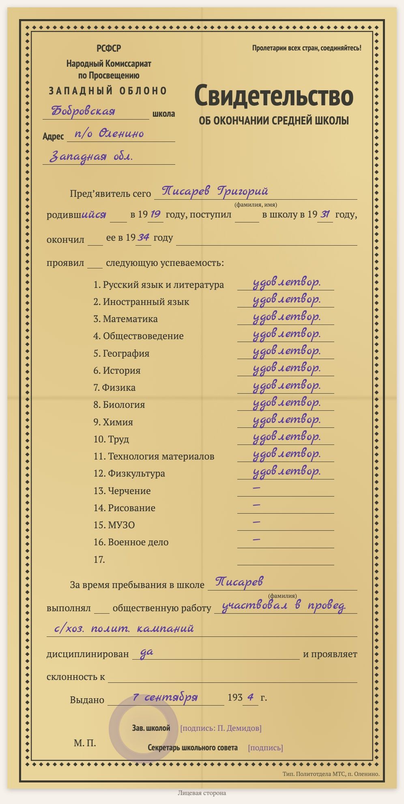

# replica-school-certificate-1930s

Мови: [English](README.md) / [Русский](README.ru.md) / [Українська](README.uk.md) / [Deutsch](README.de.md)

Входить до набору [genealogy-skills](../README.uk.md).

Робить **набрану копію радянського шкільного свідоцтва 1930-х** («Свидетельство об окончании … школы» на бланку облвно: предмети з оцінками, громадська робота, дисципліна, дата видачі, завідувач школи, секретар шкільної ради). Це не скан, а аркуш на HTML/CSS за зразком оригіналу: орнаментальна рамка, ті самі рядки, друкований текст, вписане від руки — рукописним шрифтом, печатка школи — вицвілим колом. Копія ставиться на сторінку документа разом із дослівним текстом (вписане від руки — синім курсивом) і поясненнями до прочитання; унизу сторінки зазначено, якою навичкою її зроблено.

Приклад: [D1009 — свідоцтво про закінчення школи Григорія Писарева, 1934](https://usuyukiso.github.io/family-history/sources/documents/D1009-svidetelstvo-ob-okonchanii-shkoly-pisarev-grigoriy-1934/).

## Як запустити

Навичка запуститься сама, якщо ваше прохання їй підходить, наприклад:

- «Отрисуй 1934.09.07_PisarevGrigYak_School_certificate.pdf по образцу бланка»
- «Зроби копію шкільного свідоцтва 1930-х»

Або запустіть напряму: `/replica-school-certificate-1930s <файл скану>`.

## Що вийде

- Сторінка документа `D####`: копія бланка, текст, пояснення до датування, оцінок і прочитання, зв'язок з учнем.
- Сторінку додано до меню, до списку джерел, до внутрішнього списку перевірки та на сторінку людини.
- Список сумнівних місць (предмети на згинах, підписи, печатка), щоб ви звірили їх зі сканом.

## Що потрібно

- Скан (PDF, TIFF або JPEG). На macOS PDF малюється вбудованим PDFKit.
- Один раз на сайт: стилі з [assets/replica.css](assets/replica.css), шрифти й два невеликі хуки MkDocs (див. SKILL.md).

Інструкції, яких дотримується агент, — у [SKILL.md](SKILL.md).
